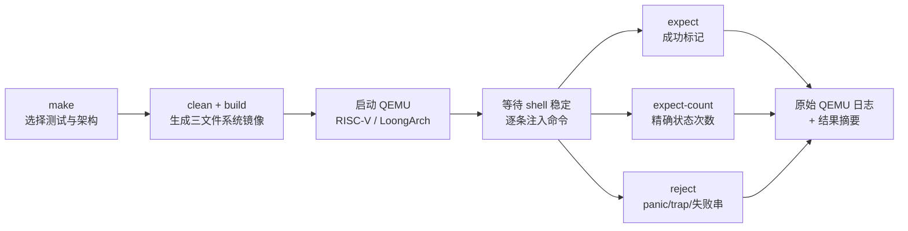
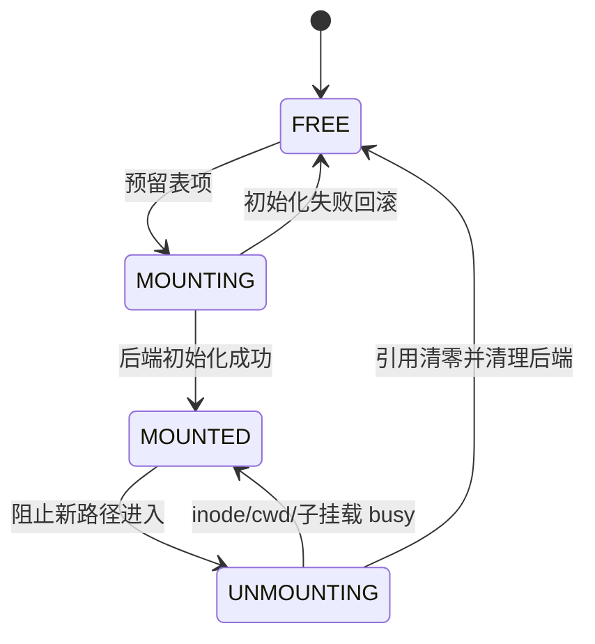

# “测试与效果”答辩 PPT 内容设计

本板块建议使用 6 页，叙事顺序为：**怎么测 → 测什么 → 最难的语义怎么证 → 压力有多大 → 结果如何 → 结论边界是什么**。不要只展示 PASS 截图，也不要把机器相关 ticks 直接包装成“高性能”。

## 第 1 页：从“命令能运行”到“系统行为可证明”

核心标题：**五层质量门禁覆盖赛题功能、语义与稳定性**

展示五层：

1. 基线兼容：xv6 `usertests` 快速版与完整版。
2. 官方要求：赛题指定 test1/test2 与四向跨文件系统复制。
3. 功能与语义：ext2/FAT32 增删改查、路径、链接、ELF、错误分支。
4. 生命周期与压力：mount/umount 四态、嵌套拓扑、CPUS=3 并发。
5. 数据证据：跨启动读回、重挂载逐字节复验、e2fsck 离线检查。

推荐画面：由下到上的五层质量门禁，不放大段终端输出。

## 第 2 页：自动化、双架构、可审计

核心标题：**同一用例、同一断言，只替换目标架构**

讲解重点：

- `make <case> && make run` 与 `make loongarch_<case> && make run` 复用同一 `cmds.sh`。
- runner 不仅看“结束标记”，还做精确次数与负断言。
- 首条和后续命令均等待提示符稳定，命令超时直接失败，避免 UART 丢字符产生假阴性。
- `logs/` 保存现场原始输出，`evidence/` 保存最终归档，结论可复核。

## 第 3 页：11 个测试点 × 2 个架构

核心标题：**22 项回归覆盖需求、后端、平台和故障路径**

建议只展示压缩矩阵：

| 测试域 | 测试点 | 主要覆盖 |
|---|---|---|
| 官方兼容 | baseline、public_vfs | rev5 语义、赛题指定流程 |
| 后端功能 | ext2、fat32 | 大文件、目录、长名、增删改查 |
| VFS 语义 | error、semantics | 错误隔离、跨盘规则、ELF、unlink-open |
| 数据生命周期 | persist、remount_io | 跨 QEMU、卸载/重挂载、逐字节校验 |
| 并发与拓扑 | smp、mount_lifecycle、mount_storm | 分配竞争、四态状态机、挂卸载竞态 |

页脚结果：`11 test points × 2 architectures = 22 runs`。

## 第 4 页：mount/umount 生命周期专项

核心标题：**测试状态转换，而不只是测试一条命令**

在图右侧放 `mount_lifecycle` 的四组证据：

- 非法/忙卸载精确 `5/5`。
- 错设备初始化失败精确 `2/2`，随后正确挂载，证明回滚完成。
- 两个挂载点删除均拒绝；子挂载存在时父卸载 busy。
- 子/父卸载后下层目录恢复，重挂载后上层数据不变。

创新性表述：这是**状态机测试 + 变形测试**。挂载前写入下层标记，卸载后标记必须重新可见；再次挂载后上层数据必须保持。

## 第 5 页：大数据、并发和完整性

核心标题：**让压力同时穿过 VFS、文件系统和 HAL**

建议用三个并列数字组：

- **8 MiB 逐字节核验**：ext2/FAT32 各写 1 MiB，三轮卸载/重挂载后各复验 3 次。
- **2048 次 worker 迭代**：CPUS=3；每后端 2 个 lookup worker + 2 个 topology worker × 256 轮。
- **三层数据证据**：会话内写后读回 → 关闭 QEMU 后读回 → `e2fsck -fn` 五阶段零错误。

技术含量说明：

- ext2 1 MiB 跨越直接块、单间接和双重间接。
- FAT32 1 MiB 覆盖长簇链分配与遍历。
- mount storm 让 lookup/open 与 mount/umount 真实竞争，验证 reader pin、`inode.ref` busy 与四态发布协议。

## 第 6 页：结果仪表板与结论边界

核心标题：**功能全绿，稳定性有量化证据，性能结论保持可复现**

建议展示：

| 指标 | 结果 |
|---|---|
| 双架构统一回归 | 22/22 PASS |
| 完整 usertests | 69 个命名测试/架构，均 `ALL TESTS PASSED` |
| mount 生命周期 | 双架构 PASS |
| 1 MiB 多轮重挂载 | 双架构 8 MiB 逐字节核验 PASS |
| CPUS=3 挂载风暴 | 双架构 2048 次 worker 迭代 PASS |
| 异常扫描 | 无 `panic:` / `kerneltrap` |
| ext2 离线检查 | e2fsck 五阶段零错误 |

结果页可放 3 张经过裁剪的真实截图：`22/22` 汇总、`UMOUNT_STRESS_OK` 双后端、`e2fsck` 结尾。不要放一整屏不可读日志。

结论边界必须主动说明：

- 正常重挂载和跨 QEMU 持久性不等于突然断电崩溃一致性。
- 单次 ticks 只作同环境复现，不比较 RISC-V 与 LoongArch 性能。
- “高性能”必须等待最终源码、固定 QEMU/CPUS/负载下的重复采样，并报告 median/p95；当前最强结论是**稳定、可复现、无明显功能回归**。

## 答辩用一句话总结

> 我们的测试不是确认命令有没有输出，而是用双架构同构用例、精确状态断言、变形测试和并发压力，验证 VFS/HAL 在功能、生命周期和数据完整性三个层面都保持正确。
