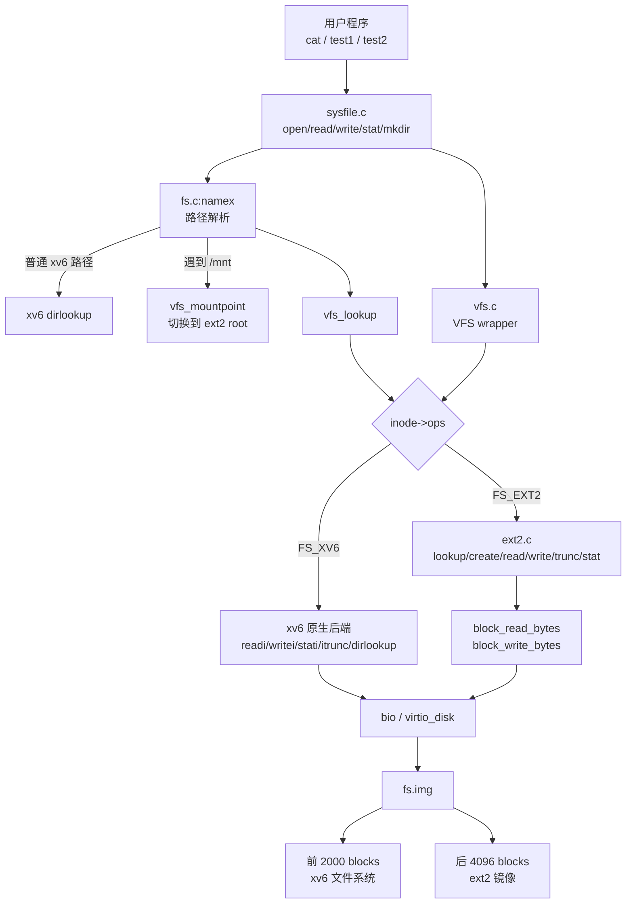
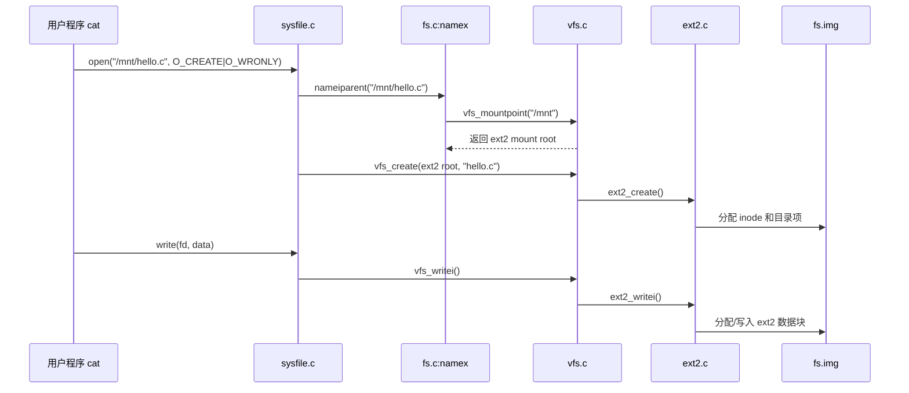

# 设计文档

> 本文件记录源码设计思路和总体结构

## 1. 设计目标

本项目围绕赛题“xv6 虚拟文件系统和硬件抽象层的设计与实现”展开。到阶段 C 为止，我们已经完成：

- 在 xv6 原有文件系统路径上增加一层薄 VFS 分发接口。
- 保持原 xv6 文件系统行为不变，并通过原始 `usertests -q`。
- 引入挂载表，使 `/mnt` 可以切换到 ext2 文件系统。
- 实现 ext2 的最小读写闭环，支持公开测试中使用的普通文件创建、读、写、截断和 stat。
- 将 ext2 镜像追加在 `fs.img` 后半部分，通过逻辑设备号 `EXT2DEV` 访问，避免大规模改动 virtio 设备模型。

设计原则：

- 小步接入：先保证 xv6 原行为稳定，再逐步接入 ext2。
- 接口薄：VFS 只提供当前测试和后续扩展真正需要的入口。
- 后端集中：ext2 逻辑集中放在 `kernel/ext2.c`，减少对原 xv6 文件系统的污染。
- 可展示：保留清晰的 `/mnt` 挂载点和跨文件系统复制路径，方便 demo 展示。

## 2. 总体结构

当前系统可以理解为三层：

- 上层：系统调用和路径解析，例如 `open/read/write/stat/mkdir`。
- 中层：VFS 分发层，根据 inode 所属文件系统选择不同操作表。
- 下层：具体文件系统后端，包括原 xv6 文件系统和 ext2 文件系统。



## 3. 核心数据结构

### 3.1 `struct inode_ops`

`inode_ops` 是 VFS 的核心分发点。每个 inode 通过 `ip->ops` 指向一组操作函数。

当前包含：

| 操作 | 作用 | xv6 后端 | ext2 后端 |
|---|---|---|---|
| `read` | 读取文件内容 | `readi` | `ext2_readi` |
| `write` | 写入文件内容 | `writei` | `ext2_writei` |
| `stat` | 获取文件元信息 | `stati` | `ext2_stati` |
| `trunc` | 截断文件 | `itrunc` | `ext2_itrunc` |
| `lookup` | 目录项查找 | `dirlookup` 包装 | `ext2_lookup` |
| `create` | 创建文件 | 原 xv6 逻辑保留在 `sysfile.c` | `ext2_create` |

这样做的好处是：上层系统调用不需要知道底层到底是 xv6 还是 ext2，只需要调用 VFS wrapper。

### 3.2 `struct mount`

`mount` 描述一次挂载实例。

关键字段：

| 字段 | 含义 |
|---|---|
| `used` | 当前挂载项是否有效 |
| `fstype` | 文件系统类型，例如 `FS_XV6`、`FS_EXT2` |
| `dev` | 逻辑设备号 |
| `mountpoint` | 被挂载覆盖的 xv6 目录 inode，例如 `/mnt` |
| `root` | 被挂载文件系统的根 inode |
| `fsops` | 文件系统级操作表 |
| `fs_private` | 文件系统私有状态，例如 ext2 的超级块和组描述符 |

当前 `fs_private` 只放在 mount 上，不再放在 inode 上。这样 inode 结构更干净，文件系统级状态也更集中。

## 4. 阶段 A：薄 VFS 虚拟文件系统分发层

阶段 A 的目标是“接入 VFS，但不改变行为”。

主要改动：

- 新增 `kernel/vfs.h` 和 `kernel/vfs.c`。
- 在 `struct inode` 中增加 `fstype`、`mnt`、`ops`。
- 在 `iget()` 中初始化 inode 的 VFS 字段，默认绑定 xv6 后端。
- 将普通文件的 `read/write/stat/O_TRUNC` 路径改为经过 VFS wrapper。
- `vfs_readi/vfs_writei/vfs_stati/vfs_itrunc` 当前仍转发回 xv6 原函数。

阶段 A 后的效果：

```text
sys_read/sys_write/sys_fstat/sys_open
        -> VFS wrapper
        -> inode->ops
        -> xv6 readi/writei/stati/itrunc
```

这个阶段证明：VFS 层可以安全插入原 xv6 文件系统路径。

## 5. 阶段 B：挂载表与块设备接口

阶段 B 的目标是让路径解析具备跨文件系统能力。

主要改动：

- 在 `vfs.c` 中维护 mount table。
- 实现 `vfs_mount()`，用于把文件系统挂到某个目录上。
- 实现 `vfs_mountpoint()`，用于判断一个 inode 是否为挂载点。
- 修改 `namex()`：路径解析遇到挂载点时，切换到被挂载文件系统的根 inode。
- 通过 `EXT2DEV` 表示 ext2 逻辑设备。
- 在 `virtio_disk.c` 中对 `EXT2DEV` 做偏移映射，使 ext2 访问落到 `fs.img` 后半部分。
- 在 `Makefile` 中生成 `ext2.img` 并追加到 `fs.img`。

阶段 B 后的路径切换：

```text
/mnt/hello.c
  -> namex 先找到 xv6 中的 /mnt
  -> vfs_mountpoint 判断 /mnt 已挂载 ext2
  -> 切换到 ext2 root
  -> 后续 hello.c 在 ext2 目录中查找
```

## 6. 阶段 C：ext2 最小读写支持

阶段 C 的目标是支持公开测试中用到的 ext2 文件访问能力。

当前 ext2 支持范围：

- 读取 ext2 superblock。
- 读取 block group descriptor。
- 读取和写回 ext2 inode。
- 支持目录项查找。
- 支持普通文件创建。
- 支持普通文件 read/write/stat/trunc。
- 支持直接块和一级间接块。
- 支持块位图和 inode 位图的最小分配。

当前暂不追求完整 ext2：

- 不支持复杂权限模型。
- 不支持完整时间戳维护。
- 不支持 ext2 下的完整 `unlink/link/rename`。
- 不支持多块组 ext2。
- 当前主要面向公开测试所需的普通文件路径。

这是一种有意的“教学型最小实现”：功能边界清晰，代码集中，便于说明和维护。

## 7. 典型运行过程

以公开测试中的命令为例：

```sh
cat hello.c > /mnt/hello.c
```

运行过程如下：



这个流程展示了当前设计的核心价值：上层命令不需要关心文件系统类型，VFS 根据 inode 自动分发。

## 8. 当前文件职责

| 文件 | 职责 |
|---|---|
| `kernel/vfs.h` | 定义 VFS 类型、操作表和挂载结构 |
| `kernel/vfs.c` | 实现 VFS 初始化、挂载表、wrapper 分发 |
| `kernel/ext2.c` | 实现 ext2 最小文件系统后端 |
| `kernel/fs.c` | 保留 xv6 原文件系统逻辑，并在路径解析处接入 VFS |
| `kernel/sysfile.c` | 在 open/create/mkdir 等路径中接入 VFS |
| `kernel/file.h` | 扩展内存 inode 的 VFS 字段 |
| `kernel/virtio_disk.c` | 将 `EXT2DEV` 映射到 `fs.img` 后半部分 |
| `kernel/param.h` | 定义 `EXT2DEV` |
| `Makefile` | 编译 VFS/ext2，并生成、追加 ext2 镜像 |

## 9. 当前状态与后续计划

当前阶段 A/B/C 已经完成并通过测试。后续建议：

- 阶段 D：实现 fat32 的最小读写支持。
- 阶段 E：整理 HAL 接口，为 LoongArch 移植做准备。
- 阶段 F：在 RISC-V 和 LoongArch 上分别跑原始 xv6 测试与 VFS 测试。
- 阶段 G：整理最终文档、Demo、diff 文件和答辩材料。
