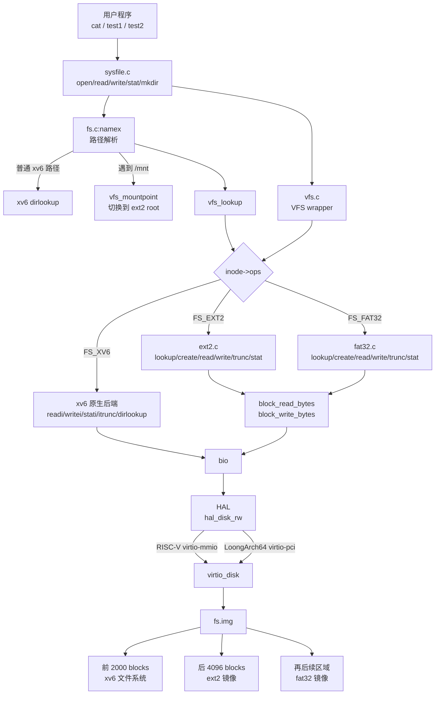
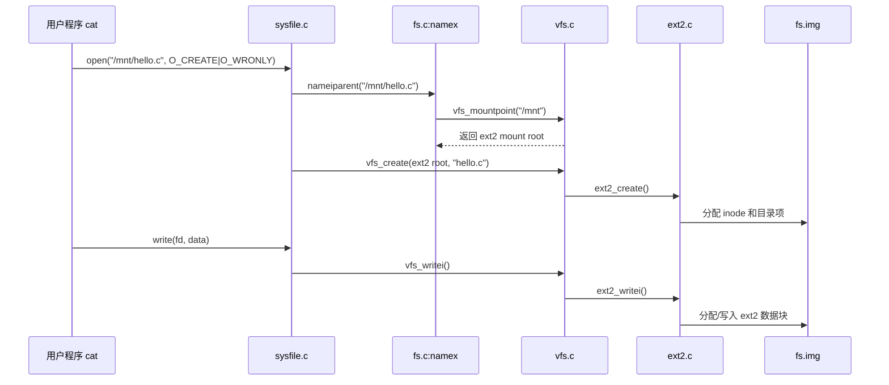

# 设计文档

> 本文件记录源码设计思路和总体结构

## 1. 设计目标

本项目围绕赛题“xv6 虚拟文件系统和硬件抽象层的设计与实现”展开。当前已经完成至阶段 G：

- 在 xv6 原有文件系统路径上增加一层薄 VFS 分发接口。
- 保持原 xv6 文件系统行为不变，并通过原始 `usertests -q`。
- 引入挂载表，使 ext2 可以通过显式 `mount ext2 /mnt` 挂载到 `/mnt`。
- 实现 ext2 的最小读写闭环，支持公开测试中使用的普通文件创建、读、写、截断和 stat。
- 将 ext2 镜像追加在 `fs.img` 后半部分，通过逻辑设备号 `EXT2DEV` 访问，避免大规模改动 virtio 设备模型。
- 接入 fat32 镜像和 `FAT32DEV`，并实现 fat32 短文件名目录遍历、普通文件读取、创建、写入和截断。
- 对 fat32 做了一轮精巧性审查和边界测试，确认当前实现保持在教学型最小闭环内。
- 引入轻量 HAL，使 RISC-V 继续使用 PLIC/virtio-mmio，LoongArch64 使用 APIC/EXTIOI 和 virtio-pci。

设计原则：

- 小步接入：先保证 xv6 原行为稳定，再逐步接入 ext2。
- 接口薄：VFS 只提供当前测试和后续扩展真正需要的入口。
- HAL 薄：只抽象中断初始化、外部中断 claim/complete 和块设备读写，避免把教学代码拆得过散。
- 后端集中：ext2 逻辑集中放在 `kernel/ext2.c`，减少对原 xv6 文件系统的污染。
- 可展示：保留清晰的 `mkdir /mnt`、`mount ext2 /mnt`、跨文件系统复制路径，方便 demo 展示。

## 2. 总体结构

当前文件系统可以理解为三层：

- 上层：系统调用和路径解析，例如 `open/read/write/stat/mkdir`。
- 中层：VFS 分发层，根据 inode 所属文件系统选择不同操作表。
- 文件系统后端：原 xv6 文件系统、ext2 文件系统和 fat32 文件系统。



## 3. 核心数据结构

### 3.1 `struct inode_ops`

`inode_ops` 是 VFS 的核心分发点。每个 inode 通过 `ip->ops` 指向一组操作函数。

当前包含：

| 操作 | 作用 | xv6 后端 | ext2 后端 | fat32 后端 |
|---|---|---|---|---|
| `read` | 读取文件内容 | `readi` | `ext2_readi` | `fat32_readi` |
| `write` | 写入文件内容 | `writei` | `ext2_writei` | `fat32_writei` |
| `stat` | 获取文件元信息 | `stati` | `ext2_stati` | `fat32_stati` |
| `trunc` | 截断文件 | `itrunc` | `ext2_itrunc` | `fat32_itrunc` |
| `lookup` | 目录项查找 | `dirlookup` 包装 | `ext2_lookup` | `fat32_lookup` |
| `create` | 创建文件 | 原 xv6 逻辑保留在 `sysfile.c` | `ext2_create` | `fat32_create` |
| `unlink` | 删除目录项 | 原 xv6 逻辑保留在 `sysfile.c` | `ext2_unlink` | `fat32_unlink` |
| `link` | 创建硬链接 | 原 xv6 逻辑保留在 `sysfile.c` | `ext2_link` | 返回错误，不支持 |

这样做的好处是：上层系统调用不需要知道底层到底是 xv6、ext2 还是 fat32，只需要调用 VFS wrapper。

### 3.2 `struct mount`

`mount` 描述一次挂载实例。

关键字段：

| 字段 | 含义 |
|---|---|
| `used` | 当前挂载项是否有效 |
| `fstype` | 文件系统类型，例如 `FS_XV6`、`FS_EXT2`、`FS_FAT32` |
| `dev` | 逻辑设备号 |
| `mountpoint` | 被挂载覆盖的 xv6 目录 inode，例如 `/mnt` |
| `root` | 被挂载文件系统的根 inode |
| `fsops` | 文件系统级操作表 |
| `fs_private` | 文件系统私有状态，例如 ext2 的超级块和组描述符 |

当前 `fs_private` 只放在 mount 上，不再放在 inode 上。这样 inode 结构更干净，文件系统级状态也更集中。

## 4. 阶段 A：薄 VFS 虚拟文件系统分发层

阶段 A 的目标是“接入 VFS，但不改变行为”。

主要改动：

- 新增 `kernel/vfs.h` 和 `kernel/vfs.c`。
- 在 `struct inode` 中增加 `fstype`、`mnt`、`ops`。
- 在 `iget()` 中初始化 inode 的 VFS 字段，默认绑定 xv6 后端。
- 将普通文件的 `read/write/stat/O_TRUNC` 路径改为经过 VFS wrapper。
- `vfs_readi/vfs_writei/vfs_stati/vfs_itrunc` 当前仍转发回 xv6 原函数。

阶段 A 后的效果：

```text
sys_read/sys_write/sys_fstat/sys_open
        -> VFS wrapper
        -> inode->ops
        -> xv6 readi/writei/stati/itrunc
```

这个阶段证明：VFS 层可以安全插入原 xv6 文件系统路径。

## 5. 阶段 B：挂载表与块设备接口

阶段 B 的目标是让路径解析具备跨文件系统能力。

主要改动：

- 在 `vfs.c` 中维护 mount table。
- 实现 `vfs_mount()`，用于把文件系统挂到某个目录上。
- 实现 `vfs_mountpoint()`，用于判断一个 inode 是否为挂载点。
- 修改 `namex()`：路径解析遇到挂载点时，切换到被挂载文件系统的根 inode。
- 保持 `mkdir` 和 `mount` 的职责分离：`mkdir /mnt` 只创建目录，`mount ext2 /mnt` 才执行挂载。
- 通过 `EXT2DEV` 表示 ext2 逻辑设备。
- 在 `virtio_disk.c` 中对 `EXT2DEV` 做偏移映射，使 ext2 访问落到 `fs.img` 后半部分。
- 在 `Makefile` 中生成 `ext2.img` 并追加到 `fs.img`。

阶段 B 后的路径切换：

```text
/mnt
  -> 先由 mkdir 在 xv6 中创建普通目录
  -> 再由 mount ext2 /mnt 写入 mount table

/mnt/hello.c
  -> namex 先找到 xv6 中的 /mnt
  -> vfs_mountpoint 判断 /mnt 已挂载 ext2
  -> 切换到 ext2 root
  -> 后续 hello.c 在 ext2 目录中查找
```

## 6. 阶段 C：ext2 最小读写支持

阶段 C 的目标是支持公开测试中用到的 ext2 文件访问能力。

当前 ext2 支持范围：

- 读取 ext2 superblock。
- 读取 block group descriptor。
- 读取和写回 ext2 inode。
- 支持目录项查找。
- 支持普通文件创建。
- 支持普通文件 read/write/stat/trunc。
- 支持直接块、一级间接块和双重间接块（单文件上限约 64MB，实际受镜像容量约束）；仅三重间接（`i_block[14]`）维持拒读。
- 支持块位图和 inode 位图的最小分配。

当前暂不追求完整 ext2：

- 不支持复杂权限模型。
- 不支持完整时间戳维护。
- 支持基础 `unlink/link`，但不支持 `rename`，也不追求完整 ext2 链接语义和复杂异常恢复。
- 不支持多块组 ext2。
- 不支持三重间接块。
- 当前主要面向公开测试所需的普通文件路径。

这是一种有意的“教学型最小实现”：功能边界清晰，代码集中，便于说明和维护。

## 7. 典型运行过程

以公开测试中的命令为例：

```sh
mkdir /mnt
mount ext2 /mnt
cat hello.c > /mnt/hello.c
```

运行过程如下：



这个流程展示了当前设计的核心价值：上层命令不需要关心文件系统类型，VFS 根据 inode 自动分发。

## 8. 当前文件职责

| 文件 | 职责 |
|---|---|
| `kernel/vfs.h` | 定义 VFS 类型、操作表和挂载结构 |
| `kernel/vfs.c` | 实现 VFS 初始化、挂载表、wrapper 分发 |
| `kernel/ext2.c` | 实现 ext2 最小文件系统后端 |
| `kernel/fat32.c` | 实现 fat32 挂载识别、目录遍历和普通文件读写 |
| `kernel/hal.c` | RISC-V 平台 HAL，连接 PLIC 和 virtio 块设备 |
| `kernel/arch/loongarch/` | LoongArch64 启动、trap、页表、切换、中断和 virtio-pci 枚举 |
| `kernel/fs.c` | 保留 xv6 原文件系统逻辑，并在路径解析处接入 VFS |
| `kernel/sysfile.c` | 在 open/create/mkdir 等路径中接入 VFS |
| `kernel/file.h` | 扩展内存 inode 的 VFS 字段 |
| `kernel/bio.c` | 通过 `hal_disk_rw()` 访问具体块设备 |
| `kernel/virtio_disk.c` | 统一 virtio 块设备驱动，并将 `EXT2DEV/FAT32DEV` 映射到 `fs.img` 后续镜像区域 |
| `kernel/param.h` | 定义 `EXT2DEV/FAT32DEV` 和镜像偏移 |
| `Makefile` | 编译 VFS/ext2/fat32，支持 `ARCH=riscv` 和 `ARCH=loongarch` |
| `mkfs/mkfat32.c` | 生成最小空 fat32 镜像，避免依赖宿主机 `mkfs.fat` |

## 9. 当前状态与后续计划

### 阶段 D：fat32 最小文件系统支持

D0 重新核对公开测试后确认：当前公开样例仍主要围绕 ext2 `/mnt` 跨文件系统复制，fat32 的挂载点、命令和操作集合尚未明确。因此 fat32 采用小步接入策略，不追求一次实现完整 FAT32，而是先完成教学型最小闭环。

当前已完成：

- 新增 `FAT32DEV`，将 fat32 镜像映射到 `fs.img` 中 xv6 和 ext2 区域之后。
- 新增 `mkfs/mkfat32.c`，生成一个空 fat32 镜像。
- `Makefile` 生成 `fat32.img` 并追加到 `fs.img`。
- 新增 `kernel/fat32.c`，读取并校验 fat32 BPB，建立 fat32 根 inode。
- 支持 `mount fat32 /fat` 显式挂载。
- 支持 8.3 短文件名目录项查找和 `ls /fat`。
- 支持普通文件 `read/write/stat/trunc`。
- 支持普通文件和目录的最小创建流程，能完成 `cat /tests/hello.c > /fat/hello.c`、覆盖写入和子目录读写。
- D4 删除 `fat32_writei()` 中不必要的预读，底层 `block_write_bytes()` 已能处理局部写入，因此代码更短、I/O 更少。
- D4 补充空文件、覆盖写、跨 cluster 文件、小目录多文件和长文件名拒绝测试。

刻意保留的边界：

- 暂不支持长文件名。
- 支持基础 `unlink`；`link/rename` 不支持，`link` 后端显式返回错误。
- 暂不维护完整时间戳、权限和 FSInfo 空闲计数。
- 当前实现面向赛题演示和公开测试风格中的普通文件路径，保持代码集中和可讲清。

### 阶段 E：轻量 HAL 与 LoongArch64 支持

当前已完成：

- 新增 `hal_disk_rw()`、`hal_intr_init()`、`hal_irq_claim()` 等薄接口。
- 中断的 claim/complete 在两个平台统一经 `hal_irq_claim()`/`hal_irq_complete()` 分发；LoongArch 侧 EXTIOI 位掩码语义与 LS7A APIC 的电平/边沿、路由差异（virtio-pci 电平触发经 APIC 清除，UART 边沿触发无需 APIC 清除）全部收敛在 `arch/loongarch/hal.c` 内部，`trap.c` 不再直接接触中断控制器。
- LoongArch 传统 INTx 信号链存在一个已实证并修复的缺陷：一次完成中断正在确认（ack/EOI）的窗口内到达的下一次完成，可能被 APIC/EXTIOI 链吞没且不再产生新中断（经完整版 `usertests` 的 `manywrites` 暴露，gdb 取证确认设备已投递完成项而客户机未处理）。修复为两层：devintr 的 virtio 分支处理循环（确认后重查 used 环），以及挂接在定时器路径上的 `virtio_disk_watchdog()` 看门狗（定时器不经过外部中断链，每 tick 兜底清理积压完成项，从机制上消除该类死锁）。
- RISC-V 路径保持 PLIC 和 virtio-mmio 块设备，`fs.img` 可由 QEMU virtio 实际读写。
- LoongArch64 路径接入 APIC/EXTIOI 和 PCI 配置空间扫描，并通过 virtio-pci 块设备访问 `fs.img`。
- LoongArch64 已能在 `qemu-system-loongarch64` 启动到 shell，运行 `usertests -q`，并在挂载 ext2 后通过 `test1/test2`。

阶段边界：

- HAL 仍保持薄封装，只覆盖中断初始化/完成、块设备读写和少量平台启动差异。
- LoongArch64 virtio-pci 当前面向 QEMU virt 机器的单磁盘场景，不实现通用 PCI 总线管理器。

当前已经完成至阶段 G，并通过阶段性测试。

### 阶段 H：VFS 语义加固与评测流程对齐

在功能齐备的基础上，对 inode 生命周期与挂载语义做了一轮以"对齐 xv6/POSIX 语义"为基准的加固：

- exec 路径解析：不含 `/` 的裸命令名在当前目录查找失败时回退根目录查找，使安装在 `/` 的程序在任意工作目录可用（官方评测流程 `cd tests; cat cmds.sh | sh` 依赖该行为）。
- 挂载点保护：三条 unlink 路径（xv6/ext2/fat32）均拒绝删除正被用作挂载点的目录；`vfs_mount` 拒绝 xv6 根文件系统的重复挂载。
- inode 缓存一致性：`ext2_iget`/`fat32_iget` 仅在缓存未命中（`valid==0`）时读盘填充，不再用磁盘旧值覆盖活动 inode 的内存状态。
- unlink 延迟释放：unlink 只减 nlink，数据块/inode/簇链的释放延迟到 `iput()` 的 `ref==1 && nlink==0` 分支，经各后端的 `itrunc` 钩子完成——打开中的文件被 unlink 后仍可读写，最后一次 close 时才释放，与 xv6 根文件系统语义一致。配套新增 `unlinkopen` 回归测试（ext2/fat32 双后端）。
- ext2 块/inode 位图分配扫描上界钳位到 `s_blocks_count`/`s_inodes_count`，防止越界分配。
- ext2 长文件名：目录列举时超长名字截断到 DIRSIZ 显示；查找时对恰为 DIRSIZ 长的查询名做唯一前缀别名匹配（namei 层本就把路径分量截断到 DIRSIZ），精确短名优先。外部镜像中的长名文件因此可以正常列出、stat 和读取。
- fat32 簇分配增加 next-free 提示（含回绕扫描与释放端下调），避免每次分配都从簇 2 全表扫描。
- 清理 LoongArch ramdisk 死代码（文件、Makefile 规则与残留声明）。
- 测试与构建基建：官方测例逐字节入库并锚定版本（`tests/VFS_TESTS_PIN.txt`），`public_vfs` 复刻官方评测流程；新增 `tests/check_env.sh` 环境检查与 `tests/run_all.sh` 双架构一键回归；镜像构建补充 `kernel/param.h` 依赖与宿主工具检查。

### 阶段 I：ext2 大文件支持与测试覆盖扩展

- 双重间接块：`ext2_bmap` 增加两级查找分支（`ext2_bmap_double`），按需分配外层表/内层表/数据块；`ext2_itrunc` 对称释放（内层表逐块→内层表→外层表）；`ext2_sync_inode` 回写 `i_block[13]` 并将间接表计入 `i_blocks`。内存 inode 地址槽位扩展为 `NDIRECT+2`（xv6 后端仍只用 +1，磁盘格式不变）；配套约束：`ilock`/`iupdate` 与磁盘 dinode 之间一律以 `sizeof(dip->addrs)` 为拷贝上界，内存扩展槽位绝不外溢到相邻 dinode。`ext2_iget` 拒读条件由"含双/三重间接"收紧为"仅三重间接"。
- 大文件回归：新增 `bigfile` 用户程序（写入 1MiB 确定性模式→逐字节读回校验→unlink，另含 `keep`/`verify` 模式供跨启动持久性验证）；ext2 镜像常驻注入 1MiB 外部文件 `hostbig.bin`（必含双重间接块），系统内以 `wc` 校验全量字节可读。
- 目录操作覆盖：ext2/fat32 套件补充 `mkdir`、嵌套路径、多文件列举用例。
- 测试运行器增加 `--final-wait`：末条命令后持续等待至全部 expect 模式出现再判定，支撑 bigfile 等长耗时用例，正常套件零拖慢。

### 阶段 F：双架构测试收口与提交材料

当前已完成：

- RISC-V `usertests -q` 通过。
- RISC-V 显式 `mount ext2 /mnt 2` 后 `test1/test2` 通过。
- LoongArch64 `usertests -q` 通过。
- LoongArch64 显式 `mount ext2 /mnt 2` 后 `test1/test2` 通过。
- 生成相对 xv6-riscv rev5 的最终 diff 与 diff 统计说明。
