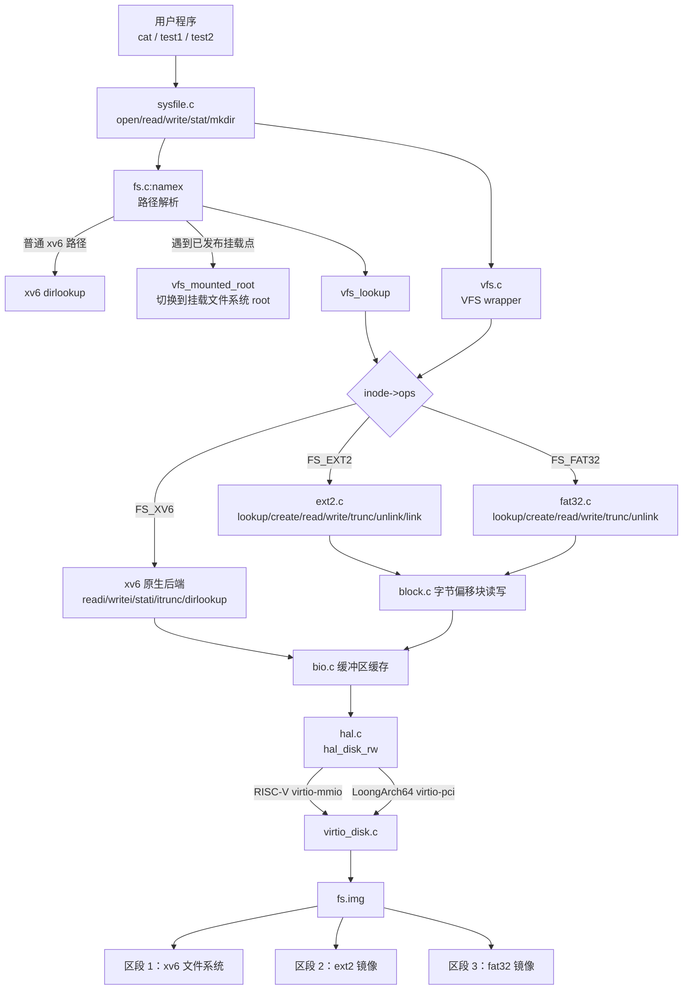
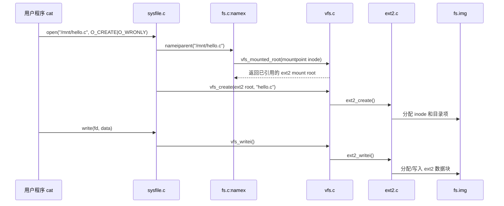

# 设计文档

本文档说明本项目的总体设计：设计目标、分层结构、关键数据结构、各子系统设计决策与设计边界。阶段进展记录见 `progress.md`，测试证据见 `contest/test_report.md` 与 `tests/evidence/`。

## 1. 设计目标与原则

赛题要求为 xv6-riscv rev5 增加 VFS 与 HAL 功能，同时支持 xv6、ext2、fat32 文件系统和 RISC-V、LoongArch 平台，且增加的代码尽量少、系统运行稳定。据此确定四条设计原则：

1. **原行为不变**：xv6 原生文件系统及其测例是回归基准，任何改动不得破坏既有行为。
2. **接口要薄**：VFS 与 HAL 只抽象当前真正需要的操作，不为假想需求预留框架。
3. **后端集中**：每种文件系统集中在一个文件中实现，不污染原 xv6 代码路径。
4. **可验证**：关键功能与主要稳定性路径有自动化回归和日志证据；难以确定触发的并发发布协议由锁序、内存序审查补充，磁盘状态可由第三方工具（e2fsck）复核。

## 2. 总体结构

系统自上而下分三层：系统调用与路径解析、VFS 分发层、文件系统后端；块设备访问经 HAL 落到单一 virtio 磁盘的不同区段。



## 3. 核心数据结构

### 3.1 `struct inode_ops`

inode 操作表是 VFS 的分发点，`ip->ops` 决定该 inode 的全部文件语义：

| 操作 | xv6 后端 | ext2 后端 | fat32 后端 |
|---|---|---|---|
| `read` / `write` / `stat` | `readi` / `writei` / `stati` | `ext2_readi` / `ext2_writei` / `ext2_stati` | `fat32_readi` / `fat32_writei` / `fat32_stati` |
| `trunc` | `itrunc` | `ext2_itrunc` | `fat32_itrunc` |
| `lookup` | `dirlookup` 包装 | `ext2_lookup` | `fat32_lookup` |
| `create` | 原 xv6 逻辑 | `ext2_create` | `fat32_create` |
| `unlink` | 原 xv6 逻辑 | `ext2_unlink` | `fat32_unlink` |
| `link` | `xv6_link` 包装 | `ext2_link` | 显式返回错误 |

上层系统调用不需要知道底层是哪种文件系统，只调用 VFS wrapper。

### 3.2 `struct mount` 与后端实例

`mount` 描述一次挂载实例，关键字段：`state`、`fstype`、`dev`、`mountpoint`（被覆盖的目录 inode）、`root`（被挂载文件系统的根 inode）、`fsops`、`fs_private`。`state` 采用三态：`MOUNT_FREE` 表示空槽，`MOUNTING` 表示表项已预留但后端仍在初始化，`MOUNTED` 表示初始化完成且可参与路径跳转。

文件系统级状态（ext2 的超级块/组描述符、fat32 的 BPB 解析结果与 `next_free` 提示）集中存放在各后端的单例结构 `ext2_fs`/`fat32_fs` 中，通过 `mnt->fs_private` 访问。每个后端实例另持有一把 sleeplock，用于分配/释放路径的串行化（见第 8 节）。

### 3.3 内存 inode 的扩展

`struct inode` 在 xv6 原生字段之外增加三类信息：

- VFS 字段：`fstype`、`mnt`、`ops`；
- 地址槽位 `addrs[NDIRECT+2]`：`+1` 供 xv6 单间接，`+2` 供 ext2 双重间接；fat32 复用 `addrs[0]`（首簇）、`addrs[1]`（目录项偏移）、`addrs[2]/[3]`（FAT 链漫游缓存：索引→簇号）。

**布局纪律**：内存 inode 比磁盘 dinode 多出的槽位绝不写盘——`ilock`/`iupdate` 与磁盘 dinode 之间一律以 `sizeof(dip->addrs)` 为拷贝上界，防止外溢覆写相邻 dinode。

## 4. VFS 层设计

### 4.1 分发而非改写

VFS 只有两张操作表（`inode_ops`、`fs_ops`）和一个挂载表（`NMOUNT` 槽）。xv6 原生文件系统注册为默认后端（`xv6_inode_ops` 指向原有函数），根挂载在 `vfsinit()` 建立。所有路径解析统一经过 VFS，但原生路径的函数一个不改——“行为不变”是结构性事实，而非测试巧合。

### 4.2 挂载语义

- `mtable.oplock` 是可睡眠操作锁，覆盖一次 `vfs_mount()` 的路径解析、冲突检查、后端初始化和最终发布/清理，使两个挂载调用按完整操作串行。它可以跨磁盘 I/O 持有；`mtable.lock` 仍是只保护挂载表字段的短持有 spinlock。
- `vfs_mount()` 锁定目标 inode，确认它仍是已链接目录；随后在 `mtable.lock` 内检查冲突并把空槽预留为 `MOUNTING`。目标 inode 一直锁到预留完成，关闭了“目录检查完成、挂载表尚未登记”期间被并发 unlink 的窗口。
- `MOUNTING` 与 `MOUNTED` 都占用挂载点，并阻止三条 unlink 路径（xv6/ext2/fat32）；相同 `fstype` 的非空表项也互斥，因为当前 ext2/fat32 后端各自使用一份静态实例状态。冲突扫描拒绝同一挂载点以及目标恰为已有挂载根的请求；xv6 根已由 `vfsinit()` 建立，用户请求不能再次挂载。
- `ops->mount()` 可能读取超级块和创建根 inode，因此必须在 `mtable.lock` 之外执行。成功后在锁内把状态发布为 `MOUNTED`；失败则在锁内清回 `MOUNT_FREE` 并释放引用。
- 路径解析只通过 `vfs_mounted_root()` 进入 `MOUNTED` 表项，绝不会看见尚未初始化完的根 inode；挂载根的 `..` 也只匹配 `MOUNTED` 表项，再经挂载表回到挂载点的父目录。
- `mkdir` 与 `mount` 职责分离：前者只建目录，后者才建立挂载关系。

### 4.3 exec 路径与 VFS 读取

官方评测流程要求在 `/tests` 目录下运行安装在根目录的程序。为此 `kexec` 对不含 `/` 的裸命令名增加一次根目录回退查找（原路径失败后用 `/` 前缀重试），约 16 行，使 `cat`、`test1` 等在任意工作目录可用，且不改变绝对路径语义。

ELF 加载也必须服从 inode 的 VFS 操作表：`kexec()` 读取 ELF 文件头、读取 program header，以及 `loadseg()` 读取可装载段的三处调用均使用 `vfs_readi()`。因此可执行文件位于 xv6、ext2 或 fat32 时都由 `ip->ops->read` 分发到正确后端，而不会误入只理解 xv6 磁盘布局的原生 `readi()`。

### 4.4 inode 生命周期语义对齐

- **缓存一致性**：`ext2_iget`/`fat32_iget` 在 `iget()` 已持有 inode 引用后，以 acquire load 检查 `valid`；命中时直接返回，避免路径查找期间额外嵌套 inode 锁。缓存未命中时获取 `ip->lock` 并再次检查 `valid`，只有首个进入者从磁盘填充共享字段，最后以 release store 发布 `valid=1`；等待者只会看到完整状态。该双检既避免磁盘旧值覆盖活动 inode，也保持 `iget()` 返回“已引用但未锁定 inode”的上层约定。fat32 根 inode 的首次初始化同样在 `ip->lock` 内完成并以 release store 发布。
- **unlink 延迟释放**：unlink 只减 `nlink` 并同步；资源释放延迟到 `iput()` 的 `ref==1 && nlink==0` 分支，经各后端 `itrunc` 钩子完成（ext2 释放数据块与 inode，fat32 释放整条簇链）。打开中的文件被 unlink 后仍可读写，最后一次 close 时才释放，与 xv6 根文件系统语义一致；`unlinkopen` 回归测试常驻守护。

## 5. ext2 后端设计

### 5.1 支持范围

读取超级块与组描述符、dinode 读写、目录项查找、普通文件与目录创建、read/write/stat/trunc/unlink/link、直接块/单间接/**双重间接块**寻址、块与 inode 位图分配。单文件上限从 268KB 提升到约 64MB（实际受镜像容量约束）；仅三重间接（`i_block[14]`）维持拒读，边界明确。

### 5.2 双重间接的实现形态

`ext2_bmap` 在单间接分支之后接入独立的两级查找函数 `ext2_bmap_double`：外层表位于 `addrs[NDIRECT+1]`，按需分配外层表、内层表与数据块（新块由分配器保证清零）；`ext2_itrunc` 对称释放（内层表逐块→内层表→外层表）；`ext2_sync_inode` 回写 `i_block[13]` 并把间接表计入 `i_blocks`（e2fsck 校验一致）。既有直接/单间接代码零改动。

### 5.3 分配与查找的健壮性

- 位图扫描上界钳位到 `s_blocks_count`/`s_inodes_count`，不依赖镜像工具对越界位的填充约定；
- 目录列举对超过 14 字符（`DIRSIZ`）的名字截断显示；查找时对恰为 14 字符的查询名做唯一前缀别名匹配（精确短名优先）——namei 层本就把路径分量截断到 14 字符，因此外部镜像中的长名文件可以正常列出、stat 和读取。

## 6. fat32 后端设计

### 6.1 支持范围

BPB 校验与挂载、8.3 短名目录项查找/创建/删除、普通文件 read/write/stat/trunc、目录创建、**LFN 长文件名读取与目录列举**。`link`/`rename` 不支持（`link` 显式返回错误），写路径维持 8.3 创建。

### 6.2 LFN 只读支持的实现形态

解析 attr `0x0F` 的长名目录项：片段按磁盘上的倒序存储，按序位重组，UTF-16 窄化为 ASCII；以短名 11 字节名的滚动校验和绑定长名链与短名项，乱序、删除项、校验失配一律断链忽略（安全降级为 8.3 可见）。匹配规则与 ext2 别名一致：14 字符内大小写不敏感精确匹配，更长名字走截断别名。目录列举显示装配长名（截断），不再显示 8.3 残名。创建与删除维持 8.3 短名，边界清晰。

### 6.3 分配器与漫游的两项优化

- **next-free 提示**：分配从上次停止处继续（含回绕扫描与释放端下调），消除每次从簇 2 全表扫描的 O(n) 分配开销；
- **链漫游缓存**：`fat32_cluster_at` 从 `addrs[2]/[3]` 缓存的最近漫游位置继续，顺序访问降为 O(1)/块，消除大文件 O(n²) 链重扫。缓存随 inode 填充/截断失效。

两项优化有本轮 P0 修复前采集的阶段性基准数据（`contest/performance.md` §3）：同负载写 273→168→57 ticks，读 86→102→4 ticks；这些记录说明优化方向，不代表最终源码性能。

## 7. HAL 与双平台设计

### 7.1 薄 HAL 接口

每平台 `hal.c` 仅 45 行，提供 `hal_intr_init`、`hal_intr_inithart`、`hal_irq_claim`、`hal_irq_complete`、`hal_disk_init`、`hal_disk_rw` 六个入口。RISC-V 侧转发 PLIC 与 virtio-mmio；LoongArch 侧转发 EXTIOI/LS7A APIC 与 virtio-pci。接口的价值不在代码量，在于**调用点唯一**：两端 `trap.c`、`bio.c` 完全同构。

### 7.2 中断路由知识收敛

LoongArch 的外部中断是位掩码语义（EXTIOI 一次报多个挂起位），且不同设备的完成路径不同：virtio-pci 为电平触发，需在 LS7A APIC 清除；UART 为边沿触发，无需 APIC 清除。这些差异全部收敛在 `arch/loongarch/hal.c` 的 `hal_irq_complete` 内部，`trap.c` 不再直触中断控制器。死代码（早期 ramdisk 后端）已整体移除。

### 7.3 丢失中断的看门狗机制

实测发现 LoongArch 传统 INTx 信号链存在一个缺陷：一次完成在确认（ack/EOI）窗口内到达时，可能被 APIC/EXTIOI 链吞没且不再产生新中断（经完整版 usertests 的 `manywrites` 暴露，gdb 取证确认设备已投递完成项而客户机未处理）。修复分两层：

- devintr 的 virtio 分支在确认后循环重查 used 环，把窗口内的完成当场处理；
- 定时器路径挂接 `virtio_disk_watchdog()`：定时器不经过外部中断链，每 tick 检查未处理的完成项并兜底唤醒，从机制上把该类死锁降为最多一个 tick 的延迟。

## 8. 并发与锁设计

锁层级与持有规则的完整定义见 `contest/lock_order.md`，要点如下：

- 主 I/O 路径的获取方向为：`ip->lock` → 后端 fs 锁（`ext2fs.lock`/`fat32fs.lock`）→ buffer cache/块锁 → `disk.vdisk_lock`；
- `mtable.oplock` 是 mount 专用的最外层 sleeplock，串行化整次挂载操作并可跨后端 I/O 持有；非 mount 路径不获取它；
- `mtable.lock` 是只保护挂载表状态的叶级短持有 spinlock。允许在持有 `ip->lock` 时获取它，但持有它时不得再获取 inode/itable、后端或 buffer 锁，也不得调用可能睡眠或进行磁盘 I/O 的函数；
- 挂载后端初始化在 `mtable.lock` 外执行，锁只负责 `MOUNTING` 预留、`MOUNTED` 发布、失败回收及短查询；
- 两个后端各一把 sleeplock，仅在分配/释放路径获取，仅允许在 inode 锁之后、缓冲锁之前取得；
- ext2 位图操作因持有缓冲块睡眠锁而天然串行；fat32 按字节接口绕开了缓冲锁，其 FAT 分配读改写必须显式加锁（否则 SMP 下双分配同一簇，已由 SMP 压测实证并修复）；
- `iput()` 的延迟释放分支在 `itable.lock` 释放后进行磁盘操作，不持 spinlock 睡眠。

## 9. 镜像与设备布局

单一 virtio 磁盘承载三个文件系统，`param.h` 以常量定义区段边界（`FSSIZE`、`EXT2SIZE`、`FAT32START` 等），`virtio_disk.c` 按逻辑设备号（1/2/3）把读写偏移映射到对应区段。镜像构建链：`mkfs`（xv6 根）→ `mkfs.ext2 + debugfs`（ext2 与夹具文件）→ `mkfat32`（fat32 与 LFN 夹具文件）→ 依次追加。区段常量变更通过 Makefile 依赖自动触发镜像重建，布局不会静默错位。

官方测例的装载由 mkfs 的一级目录支持完成：`test1/test2/hello/cmds.sh/hello.c` 置于镜像 `/tests` 目录，复现官方评测流程所需的布局。

## 10. 典型运行过程

以公开测试中的命令为例：

```sh
mkdir /mnt
mount ext2 /mnt
cat hello.c > /mnt/hello.c
```



上层命令不需要关心文件系统类型，VFS 根据 inode 自动分发。

## 11. 文件职责

| 文件/目录 | 职责 |
|---|---|
| `kernel/vfs.c`、`vfs.h` | VFS 类型、操作表、三态挂载表与 wrapper 分发（406 + 54 行） |
| `kernel/ext2.c` | ext2 后端：dinode、目录、位图、直接与双重间接寻址 |
| `kernel/fat32.c` | fat32 后端：BPB/FAT/簇链、8.3 与 LFN 目录项 |
| `kernel/block.c`、`block.h` | 字节偏移块读写辅助层（ext2/fat32 共用） |
| `kernel/hal.c` | RISC-V 侧 HAL 薄接口 |
| `kernel/arch/loongarch/` | LoongArch 移植层：启动、页表/TLB refill、trap、APIC/EXTIOI、virtio-pci |
| `kernel/virtio_disk.c` | 共享 virtio 磁盘驱动与中断看门狗 |
| `kernel/fs.c` | xv6 原生文件系统；`iput()` 含非 xv6 后端的延迟释放分支 |
| `kernel/sysfile.c` | 系统调用入口；挂载点删除保护 |
| `kernel/exec.c` | `kexec`、裸命令名根目录回退与 ELF 内容的 VFS 读取 |
| `kernel/file.h` | 内存 inode 结构（VFS 字段与扩展地址槽位） |
| `kernel/param.h` | 设备号与镜像区段常量 |
| `mkfs/mkfs.c` | 镜像打包（支持一级目录） |
| `mkfs/mkfat32.c` | fat32 镜像生成与夹具文件注入 |
| `src/Makefile` | 双架构构建（工具链前缀回退）、镜像生成链 |

## 12. 设计边界（明确的非目标）

以下各项是有意不做的范围，理由是超出赛题硬性要求，或在教学规模下风险大于收益：

- fat32 LFN **写**、rename、symlink、umount；
- 完整挂载拓扑与祖先覆盖检测：`oplock` 只串行挂载调用，顺序执行“先挂 `/a/b`、再挂 `/a`”仍会遮蔽前一挂载，该反向祖先覆盖是当前 P1 限制；
- ext2 三重间接（`i_block[14]` 维持拒读）、多 block group；
- ext2/fat32 的日志与崩溃一致性（写直达换取简单性，取舍已在本文件说明）；
- procfs/tmpfs 等额外后端，VFS 对象模型与错误码体系的重构；
- 通用 PCI 总线管理器（LoongArch virtio-pci 面向 QEMU virt 单磁盘场景）。

## 13. 验证方式

关键功能与主要稳定性路径均有对应测试：三系统共存与官方流程（`public_vfs`）、后端功能面（`ext2`/`fat32`）、语义边界（`semantics`/`error`）、持久化（`persist`）、并发（`smp`）、原生回归与完整 usertests（`test_baseline`/`full_usertests.sh`），以及 `e2fsck` 对 ext2 镜像的五阶段离线校验。冷 inode 首访和 `MOUNTING` 发布窗口没有带屏障的确定性触发测试，其正确性依据锁序/内存序审查，自动化回归用于确认修复没有引入功能退化。结果汇总见 `contest/test_report.md` 与 `tests/MATRIX.md`。
